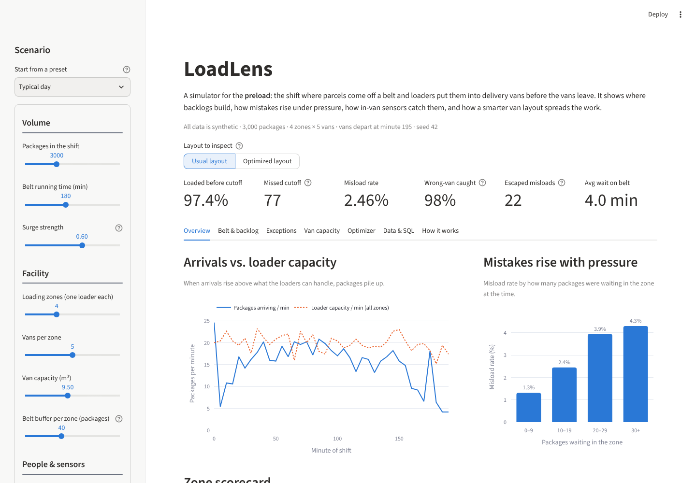

# LoadLens

**A parcel preload simulator, misload detector and loading-zone optimizer.**

In parcel delivery, the *preload* is the early-morning shift when packages come off a conveyor belt and loaders
put each one into the right delivery van, on the right shelf, before the vans leave. It is fast, physical work
under a hard deadline. When the belt surges, packages pile up, mistakes rise, and a package in the wrong van
means a failed delivery and an extra trip.

LoadLens simulates a preload shift minute by minute and answers four practical questions:

1. **Where and when does the belt back up?**
2. **How much do mistakes rise under pressure, and how many do in-van sensors catch?**
3. **Which vans will run out of room, and what should be moved before loading starts?**
4. **Can a smarter assignment of vans to loading zones spread the work and prevent missed packages?**

> All data is synthetic. LoadLens does not use, describe or represent any real company, facility or dataset.

**Live demo:** _https://loadlens-logistics.streamlit.app/_



---

## Results on the default scenario

3,000 packages, 4 loading zones with 5 vans each, a 180-minute belt window, seed 42.
Both layouts face exactly the same packages and random events.

| KPI | Usual layout | Optimized layout | Change |
|---|---:|---:|---:|
| Packages loaded before cutoff | 97.4% | **100%** | +2.6 pts |
| Packages that missed the vans | 77 | **0** | −77 |
| Misload rate | 2.46% | **2.00%** | −19% |
| Misloads that escaped | 22 | **16** | −27% |
| Average wait on the belt | 4.0 min | **1.7 min** | −58% |
| Packages sent around the belt again | 213 | **4** | −98% |
| Busiest zone, busiest 15 minutes | 110 packages | **76 packages** | −31% |

The optimizer moved 11 of 20 vans and solved to optimality in about one second.

Two findings worth noting:

- **Pressure drives mistakes.** In the usual layout the misload rate rises from 1.3% when fewer than 10
  packages are waiting to 4.3% when 30 or more are waiting.
- **Van-level sensing is not shelf-level sensing.** Sensors caught 98% of wrong-van loads, but wrong-shelf
  loads are invisible to them, and they make up most of the misloads that escape.

---

## Features

| Area | What it does |
|---|---|
| **Synthetic data generator** | Builds a realistic manifest: uneven route volumes, four size classes, two arrival surges, delivery-stop-based shelf positions, priority packages. |
| **Shift simulation** | Minute-by-minute queue model per zone with random loader speed, a limited belt buffer, recirculation and a pressure-dependent error rate. |
| **Misload detection** | Simulated in-van sensors with a configurable read rate. Raises real-time exceptions and separates caught, escaped, wrong-shelf, no-read and missed-cutoff cases. |
| **Capacity forecast** | Flags vans that will overflow *before* the shift starts and recommends where to move the excess. |
| **Zone optimizer** | Constraint-programming model (Google OR-Tools CP-SAT) that reassigns vans to zones to flatten the peak workload. Falls back to a greedy heuristic if OR-Tools is missing. |
| **Relational database** | Normalized SQLite schema with keys, constraints, indexes and reporting views. Ports to SQL Server or PostgreSQL. |
| **Interactive dashboard** | Streamlit app with presets, KPI deltas, charts, a filterable exception log, a read-only SQL console and downloads. |
| **BI export** | One CSV per table and view, ready for Power BI or Excel. |
| **Tests and CI** | 28 pytest tests and a GitHub Actions workflow. |

---

## Quick start

```bash
git clone https://github.com/waqarahmed2310/loadlens.git
cd loadlens
python -m venv .venv
source .venv/bin/activate          # Windows: .venv\Scripts\activate
pip install -r requirements-dev.txt

streamlit run app.py               # open the dashboard
pytest -q                          # run the tests
python -m loadlens.cli --out data/ # command-line run: writes data/loadlens.db, CSVs and kpis.json
```

Python 3.11 or newer is required.

### Command-line options

```bash
python -m loadlens.cli --packages 5000 --zones 6 --vans-per-zone 4 --loader-rate 4.5 --surge 0.8 --seed 7 --out data/
python -m loadlens.cli --no-optimize
```

---

## Deploy to Streamlit Community Cloud (free)

1. Push this repository to GitHub (public).
2. Go to [share.streamlit.io](https://share.streamlit.io) and sign in with GitHub.
3. Click **Create app**, choose the repository, branch `main` and main file `app.py`.
4. Under **Advanced settings**, choose Python **3.12**.
5. Click **Deploy**. Paste the resulting link at the top of this README.

---

## How it works

```
 ┌─────────────────┐   ┌──────────────────┐   ┌─────────────────┐   ┌──────────────────┐
 │ data_generator  │──▶│    simulator     │──▶│    detection    │──▶│     metrics      │
 │ synthetic shift │   │ minute-by-minute │   │ in-van sensors, │   │ KPIs, zone       │
 │ zones/vans/pkgs │   │ queues & errors  │   │ exception log   │   │ scorecard        │
 └────────┬────────┘   └────────▲─────────┘   └─────────────────┘   └────────┬─────────┘
          │                     │ optimized layout                           │
          │            ┌────────┴─────────┐   ┌─────────────────┐            ▼
          ├───────────▶│    optimizer     │   │    capacity     │   ┌──────────────────┐
          │            │ OR-Tools CP-SAT  │   │ van fill        │   │ database (SQLite)│
          └───────────▶│ van → zone       │   │ forecast        │──▶│ + CSV export     │
                       └──────────────────┘   └─────────────────┘   └────────┬─────────┘
                                                                             ▼
                                                                    Streamlit dashboard
```

**Simulation.** Each zone has one loader who handles a Poisson-distributed number of packages per minute.
A zone holds up to `belt_buffer` waiting packages; beyond that, new arrivals go around the belt and return a few
minutes later. The chance of a mistake grows with the backlog:

```
p(error) = base_error_rate × (1 + pressure_factor × backlog / belt_buffer)
```

70% of mistakes put the package in the wrong van (usually the neighbouring one); the rest put it on the wrong shelf.

**Optimization.** Binary variable `x[v, z] = 1` if van `v` parks in zone `z`. Each van gets exactly one zone and
each zone keeps the same number of spots. Using planned arrivals per 15-minute bucket from the manifest, the
model minimizes, in order of priority:

1. the highest 15-minute load on any zone (surge-aware balancing),
2. the gap between the busiest and quietest zone over the whole shift,
3. the number of vans moved from their usual spot.

**Fair comparison.** Random draws are made once per package and per zone-minute ("common random numbers"),
so the usual and optimized layouts face identical luck, and the difference comes from the layout alone.

**Simplifications.** One loader per zone, no breaks, no help shared between zones, and a simple error model.
These keep the project small and explainable; see the roadmap for extensions.

---

## Project structure

```
loadlens/
├── app.py                     Streamlit dashboard
├── loadlens/
│   ├── config.py              Scenario settings (one immutable object per run)
│   ├── data_generator.py      Synthetic zones, vans and package manifest
│   ├── simulator.py           Minute-by-minute shift simulation
│   ├── detection.py           Sensor reads and exception log
│   ├── capacity.py            Van fill forecast and recommendations
│   ├── optimizer.py           OR-Tools CP-SAT van-to-zone assignment
│   ├── metrics.py             KPIs and zone scorecard
│   ├── pipeline.py            Runs everything end to end
│   ├── database.py            SQLite build, CSV export, read-only SQL
│   ├── charts.py              Plotly figures
│   └── cli.py                 Command-line entry point
├── sql/schema.sql             Tables, constraints, indexes and views
├── tests/test_loadlens.py     Unit and integration tests
├── docs/
│   ├── data_dictionary.md     Every table and column, plus the ER diagram
│   ├── project_plan.md        Goals, milestones and success measures
│   ├── powerbi_guide.md       Building a Power BI report on the export
│   └── presentation_outline.md  10-minute results presentation
└── .github/workflows/tests.yml  Continuous integration
```

---

## Documentation

- [Data dictionary and ER diagram](docs/data_dictionary.md)
- [Project plan and milestones](docs/project_plan.md)
- [Power BI guide](docs/powerbi_guide.md)
- [Presentation outline](docs/presentation_outline.md)

---

## Roadmap

- Shelf-level sensing and its effect on escaped misloads
- Floating helpers who move to the busiest zone
- Loader breaks and shift handovers
- Live re-optimization during the shift when a trailer arrives late
- A Power BI report file (`.pbix`) built on the CSV export

---

## License

MIT. See [LICENSE](LICENSE).
