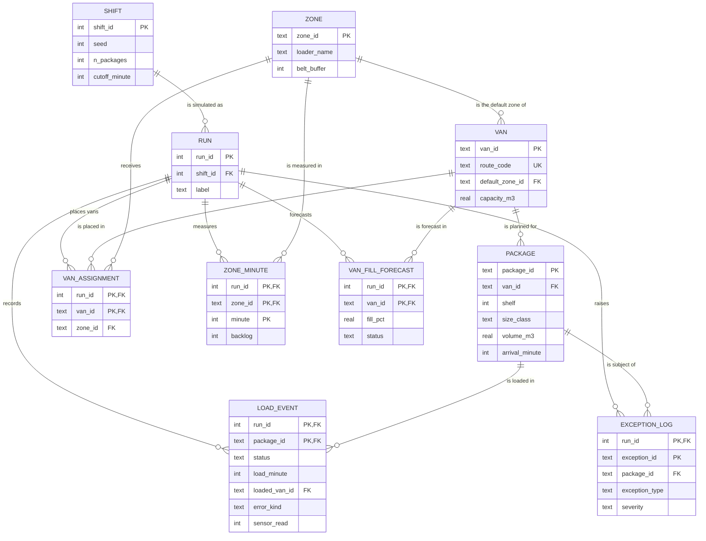

# Data dictionary

The schema lives in [`sql/schema.sql`](../sql/schema.sql). It has three layers:

- **Master data** describes the shift: `shift`, `zone`, `van`, `package`.
- **Run data** describes one simulated layout: `run`, `van_assignment`.
- **Event data** records what happened in a run: `load_event`, `exception_log`, `zone_minute`, `van_fill_forecast`.

Every shift is simulated twice (run 1 = usual layout, run 2 = optimized layout), so event tables are keyed by
`run_id`. One query can compare both layouts.

## Entity-relationship diagram

## Tables

### `shift`
One row per simulated shift.

| Column | Type | Description |
|---|---|---|
| shift_id | INTEGER, PK | Shift identifier. |
| seed | INTEGER | Random seed. Same seed and settings reproduce the same shift. |
| n_zones | INTEGER | Number of loading zones. |
| vans_per_zone | INTEGER | Van spots per zone. |
| n_packages | INTEGER | Packages in the manifest. |
| shift_minutes | INTEGER | Minutes the inbound belt runs. |
| cutoff_minute | INTEGER | Minute the vans depart. |
| config_json | TEXT | Full scenario settings as JSON. |
| created_at | TEXT | UTC timestamp of the run (ISO 8601). |

### `zone`
Loading zones along the belt; one loader each.

| Column | Type | Description |
|---|---|---|
| zone_id | TEXT, PK | Zone code, e.g. `Z1`. |
| zone_index | INTEGER, unique | Zone order along the belt (0-based). |
| loader_name | TEXT | Generated label, e.g. `Loader 01`. |
| belt_buffer | INTEGER | Waiting packages the zone can hold before packages recirculate. |

### `van`
Delivery vans and their routes.

| Column | Type | Description |
|---|---|---|
| van_id | TEXT, PK | Van code, e.g. `V07`. |
| route_code | TEXT, unique | Delivery route served by the van. |
| default_zone_id | TEXT, FK → zone | Zone the van usually parks in. |
| position_in_zone | INTEGER | Parking position within the default zone. |
| capacity_m3 | REAL | Usable cargo volume. |
| shelves | INTEGER | Shelf sections inside the van. |
| route_weight | REAL | Share of total volume going to this route. |
| route_time_bias | REAL | Whether this route's freight tends to arrive early (−) or late (+). |

### `package`
The shift manifest.

| Column | Type | Description |
|---|---|---|
| package_id | TEXT, PK | Package code, e.g. `PKG000123`. |
| van_id | TEXT, FK → van | Van the package is planned for. |
| shelf | INTEGER | Planned shelf section (1 = nearest the door, first stops). |
| stop_sequence | INTEGER | Delivery stop number on the route (1–180). |
| size_class | TEXT | `small`, `medium`, `large` or `irregular`. |
| volume_m3 | REAL | Package volume. |
| weight_kg | REAL | Package weight. |
| is_priority | INTEGER (0/1) | Time-critical package. |
| arrival_minute | INTEGER | Minute the package reaches the belt. |

### `run`
One simulated layout of a shift.

| Column | Type | Description |
|---|---|---|
| run_id | INTEGER, PK | 1 = usual layout, 2 = optimized layout. |
| shift_id | INTEGER, FK → shift | Shift simulated. |
| label | TEXT | `baseline` or `optimized`. |

### `van_assignment`
Which zone each van parks in, per run.

| Column | Type | Description |
|---|---|---|
| run_id | INTEGER, PK, FK → run | Run. |
| van_id | TEXT, PK, FK → van | Van. |
| zone_id | TEXT, FK → zone | Zone the van parks in for this run. |

### `load_event`
What happened to each package in a run.

| Column | Type | Description |
|---|---|---|
| run_id | INTEGER, PK, FK → run | Run. |
| package_id | TEXT, PK, FK → package | Package. |
| zone_id | TEXT, FK → zone | Zone that handled it. |
| status | TEXT | `loaded` or `missed` (still on the belt at cutoff). |
| load_minute | INTEGER, nullable | Minute it was loaded. |
| wait_minutes | INTEGER, nullable | Minutes between arrival and loading. |
| loaded_van_id | TEXT, FK → van, nullable | Van it actually went into. |
| loaded_shelf | INTEGER, nullable | Shelf it actually went onto. |
| error_kind | TEXT | `none`, `wrong_van` or `wrong_shelf`. |
| recirculations | INTEGER | Times it went around the belt because the zone was full. |
| sensor_read | INTEGER (0/1) | Whether the in-van sensor read it. |
| sensed_van_id | TEXT, FK → van, nullable | Van the sensor reported. |

### `exception_log`
Exceptions raised in a run.

| Column | Type | Description |
|---|---|---|
| run_id | INTEGER, PK, FK → run | Run. |
| exception_id | TEXT, PK | Exception code, e.g. `EX00042`. |
| package_id | TEXT, FK → package | Package concerned. |
| zone_id | TEXT, FK → zone | Zone where it happened. |
| minute | INTEGER | Minute of shift. |
| exception_type | TEXT | `WRONG_VAN_CAUGHT`, `WRONG_VAN_ESCAPED`, `WRONG_SHELF`, `NO_READ` or `MISSED_CUTOFF`. |
| severity | TEXT | `high`, `medium` or `low`. Priority packages raise severity. |
| detected_in_real_time | INTEGER (0/1) | Whether the system would have flagged it during the shift. |
| planned_van_id | TEXT, FK → van | Van it was planned for. |
| loaded_van_id | TEXT, FK → van, nullable | Van it went into. |
| sensed_van_id | TEXT, FK → van, nullable | Van the sensor reported. |
| is_priority | INTEGER (0/1) | Time-critical package. |
| description | TEXT | Plain-language explanation. |

### `zone_minute`
Minute-by-minute measurements per zone.

| Column | Type | Description |
|---|---|---|
| run_id | INTEGER, PK, FK → run | Run. |
| zone_id | TEXT, PK, FK → zone | Zone. |
| minute | INTEGER, PK | Minute of shift. |
| arrivals | INTEGER | Packages that entered the zone's queue. |
| recirculated | INTEGER | Packages turned away because the zone was full. |
| loaded | INTEGER | Packages loaded. |
| capacity | INTEGER | Packages the loader could have handled. |
| backlog | INTEGER | Packages waiting at the end of the minute. |

### `van_fill_forecast`
Pre-shift capacity forecast per van.

| Column | Type | Description |
|---|---|---|
| run_id | INTEGER, PK, FK → run | Run. |
| van_id | TEXT, PK, FK → van | Van. |
| zone_id | TEXT, FK → zone | Zone in this run. |
| planned_packages | INTEGER | Packages in the manifest. |
| planned_volume_m3 | REAL | Total planned volume. |
| planned_weight_kg | REAL | Total planned weight. |
| priority_packages | INTEGER | Planned priority packages. |
| fill_pct | REAL | Planned volume as % of capacity. |
| spare_m3 | REAL | Remaining room (negative = overflow). |
| status | TEXT | `ok` (< 85%), `watch` (85–100%), `overflow` (> 100%). |
| recommendation | TEXT | Suggested action for watch and overflow vans. |

## Views

| View | Purpose |
|---|---|
| `v_zone_performance` | Zone scorecard per run: packages, loaded, missed, misloads, misload rate, average wait. |
| `v_exception_summary` | Exceptions by type and severity, with how many were caught in real time. |
| `v_van_fill` | Van fill forecast joined with route and capacity. |
| `v_throughput_15min` | Arrivals, loads and peak backlog in 15-minute buckets, ready for line charts. |

## Porting to SQL Server

The schema is written to be portable. For SQL Server:

| SQLite | SQL Server |
|---|---|
| `TEXT` (keys and codes) | `VARCHAR(n)` |
| `TEXT` (descriptions, JSON) | `NVARCHAR(MAX)` |
| `INTEGER` used as 0/1 | `BIT` |
| `REAL` | `DECIMAL(10,4)` or `FLOAT` |
| `CREATE ... IF NOT EXISTS` | `IF OBJECT_ID(...) IS NULL` guard, or drop and recreate |
| `PRAGMA foreign_keys = ON` | Remove (always enforced) |
| `SUM(condition)` in views | `SUM(CASE WHEN condition THEN 1 ELSE 0 END)` |
